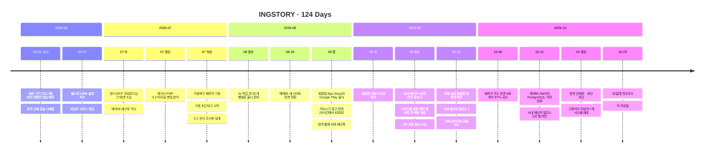
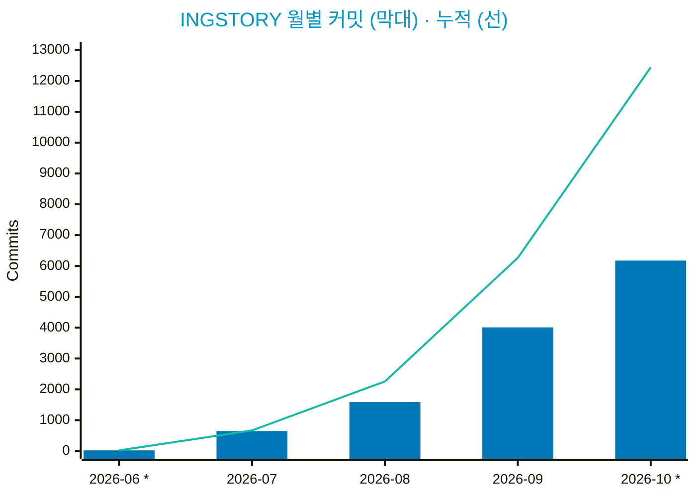
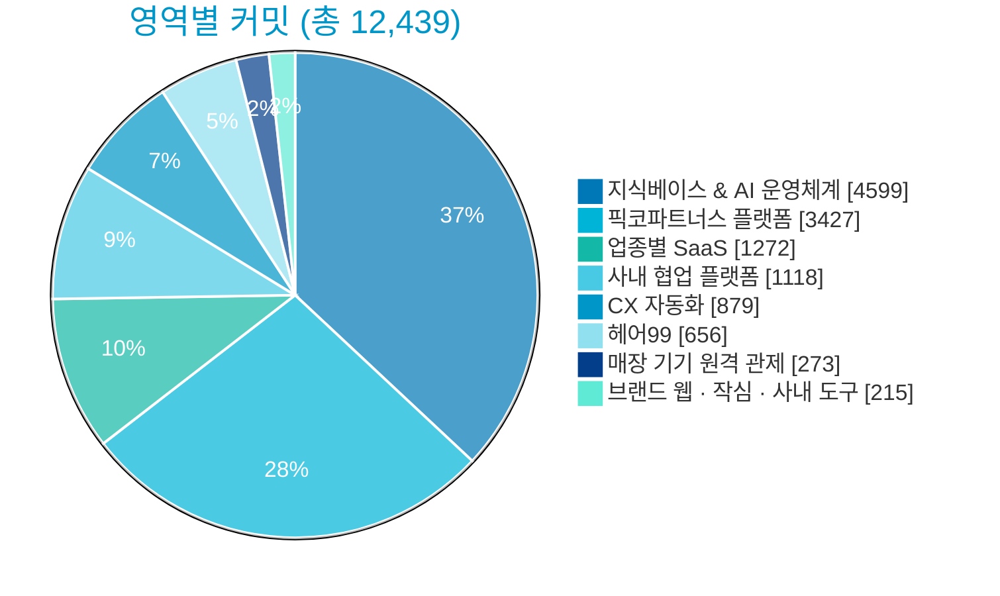
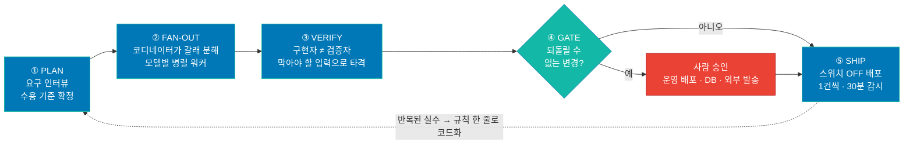
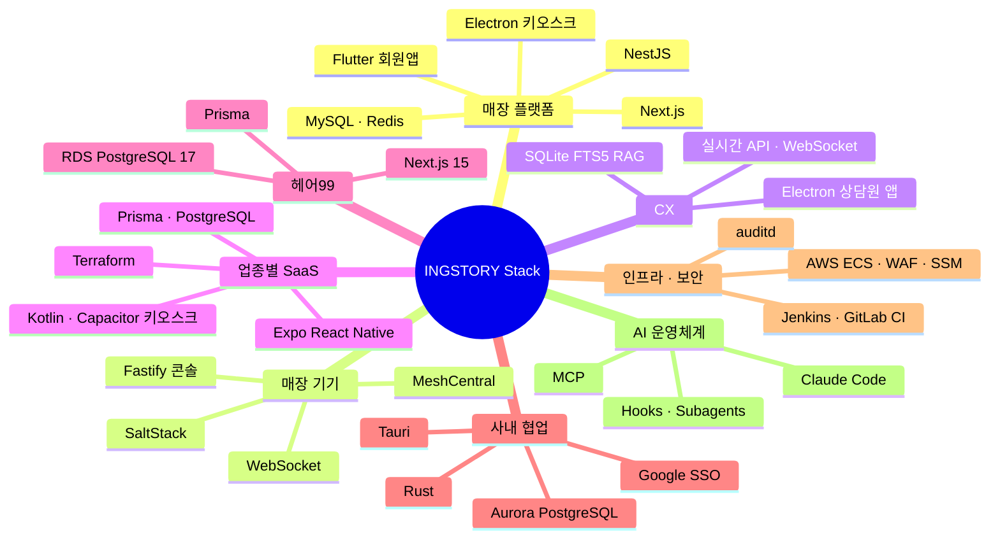

<a name="readme-top"></a>

<!-- ============ HERO ============ -->
<div align="center">

<picture>
  <source media="(prefers-color-scheme: dark)" srcset="https://raw.githubusercontent.com/doublesilver/doublesilver/main/assets/hero-dark.svg">
  
</picture>

<!-- ============ TYPING ============ -->
<a href="https://www.ingstory.co.kr">

</a>

<!-- ============ CONTACT ============ -->
[](https://www.ingstory.co.kr)
[](mailto:korea5410@gmail.com)


<!-- ============ LIVE (HTTP 200 실측 2026-10-23) ============ -->
[](https://hair99.co.kr)
[](https://gagisiro.com)
[](https://maintenance-app-azure.vercel.app)
[](https://internetdinor.vercel.app)
[](https://oddparty.vercel.app)
[](https://s-partners.vercel.app)

<!-- ============ NAV ============ -->
[](#now--ingstory)
[](#journey)
[](#by-the-numbers)
[](#how-i-work)
[](#tech-stack)
[](#personal-projects)
[](#github-activity)
[](#contact)

<picture>
  <source media="(prefers-color-scheme: dark)" srcset="https://raw.githubusercontent.com/doublesilver/doublesilver/main/assets/divider-dark.svg">
  
</picture>

</div>

> [!NOTE]
> **TL;DR — 아이엔지스토리(INGSTORY) 풀스택 개발기획 총괄.** 2026-06-22 입사 후 124일 동안 매장 통합관리 플랫폼, 전국 매장 기기 원격 관제, CX 자동화, 업종별 SaaS, 헤어99 재구축, 사내 협업 플랫폼, 인프라·보안, AI 운영체계까지 **8개 영역**을 맡았습니다.
> **기획·설계·검증과 최종 판단은 제가, 구현은 AI 에이전트(Claude Code)가 맡습니다.** 그래서 제 일의 중심은 "무엇을 만들지"와 "정말 됐는지 어떻게 증명할지"입니다.

---

## Now @ INGSTORY

**(주)아이엔지스토리** — 공간 브랜드 개발·인테리어·무인운영 토탈 솔루션 회사입니다. 스터디카페 브랜드 **작심**, 유·무인 매장 통합관리 시스템 **픽코파트너스**(스터디카페·헬스장·태닝샵·무인창고·공유오피스·무인키즈카페·파티룸·F&B 등 업종별 프로그램), 미용업계 구인구직 플랫폼 **헤어99**를 운영합니다.

저는 **풀스택 개발기획 총괄**로서 요구를 인터뷰해 수용 기준으로 바꾸고, 작업을 갈래로 쪼개 AI 워커들에게 병렬로 맡기고, 결과를 독립 검증한 뒤 되돌릴 수 없는 변경만 직접 승인합니다. 새 기능은 스위치를 끈 채 배포하고, 운영 반영은 1건씩 하고, 매번 30분 감시합니다.

> [!IMPORTANT]
> **커밋 12,439건은 이렇게 읽어 주세요.**[^commits] 사내 저장소 72개에서 본인 계정 커밋을 병합 제외·중복 제거해 센 값입니다. 대부분은 **AI 에이전트가 작업 단위로 남긴 커밋**이고, 지식베이스·업무원장 커밋 **4,599건**이 포함돼 있습니다. 사람이 직접 친 코드의 양이 아니라 **지휘한 작업의 밀도**로 봐 주세요.

<div align="center">

<picture>
  <source media="(prefers-color-scheme: dark)" srcset="https://raw.githubusercontent.com/doublesilver/doublesilver/main/assets/stats-dark.svg">
  
</picture>

<picture>
  <source media="(prefers-color-scheme: dark)" srcset="https://raw.githubusercontent.com/doublesilver/doublesilver/main/assets/skyline-dark.svg">
  
</picture>

<picture>
  <source media="(prefers-color-scheme: dark)" srcset="https://raw.githubusercontent.com/doublesilver/doublesilver/main/assets/domains-dark.svg">
  
</picture>

</div>

카드를 누르면 영역별 성과가 펼쳐집니다. 성능 수치는 모두 같은 조건에서 잰 **전후 실측값**입니다.[^perf]

<details open>
<summary><b>🏪 1. 픽코파트너스 플랫폼</b> — 유·무인 매장 통합관리 (관리자 · 회원앱 · 키오스크 · 결제) · <code>3,427 commits</code></summary>

<br/>

> 스터디카페·헬스 등 유·무인 매장을 운영하는 통합관리 플랫폼입니다. 관리자 시스템 이관, 회원앱 리뉴얼, 예약·결제 기능, 운영 DB 최적화를 총괄했습니다.

- ⚡ **배치가 주는 운영 DB 부하 −87%** — 부하 대부분을 차지하던 배치 쿼리를 실측으로 찾아, 운영 스냅샷 시험 DB에서 결과가 같은지 대조한 뒤 서버 한 대씩 적용. 읽는 행 수 **1/767**, 회원 목록 조회 **3.53s → 0.11s**
- 🏗️ **레거시 PHP 관리자 → NestJS·Next.js 점진 이관(strangler)** — 구 화면 **96개** 분류, 스테이징 전수 점검 **350건 통과(실패 0)**, 자동 테스트 **약 7,800건**을 갖추고 화면 묶음별로 순차 개통 중
- 📱 **회원앱 리뉴얼 출시(iOS · Android)** — 스토어 리뷰 **618건**을 분석해 과제를 정함. 첫 화면 폰트 **2.2MB → 130KB**, 좌석 배치도 렌더 **34.8s → 0.17s**
- 🪑 **고정석·자유석 동시 이용 기능(7개 시스템)** — 정답표 **4,824칸 대조 불일치 0**, 통합 e2e **83건** 통과, 시스템별로 하나씩 순차 배포
- 🖥️ **키오스크 광고 반영 최악 26시간 → 83초**, 대형 매장 일괄 퇴실 화면 **319s → 1s**
- 💳 **스터디룸 묶음 예약·결제·환불** — DB 구조를 바꾸지 않고 기능 스위치로 단계 배포, 환불·출입권한 회수·정산을 한 흐름으로 묶음. 중복 주문 방지·재구매 링크로 결제 완료율을 높임

**Stack** `NestJS` `Next.js` `React` `Vite` `Flutter` `Electron` `Node.js` `MySQL` `Redis` `MongoDB` `AWS` `Jest` `Vitest`
**기간** 2026-06 → 진행 중

</details>

<details>
<summary><b>🛰️ 2. 매장 기기 원격 관제</b> — 전국 매장 PC·키오스크 원격 운영 · <code>273 commits</code></summary>

<br/>

> 전국 매장 PC·키오스크를 현장 방문 없이 점검·복구·배포하는 체계와 자체 원격지원 콘솔을 만들었습니다.

- 🛰️ **오픈소스 Salt 기반 원격관리 체계** — 전국 매장 기기를 일괄 점검·복구·배포. 원격 통제 서버를 재구축해 **인증 실패 0**으로 연결을 넘기고, 누구나 처음부터 재구축할 수 있는 런북을 남김
- 🎛️ **상용 도구를 대체하는 자체 원격지원 콘솔** — Fastify·Next.js, Salt·MeshCentral 연동, 감사 기록·권한·Google 로그인. 원격 연결 **13.3s → 1.1s**, 영업 매장 **88%** 등록, 통합 시험 **1,075건** 통과
- 🔁 **통신상태 현황판 + 자동복구 폐루프** — 불량이 **3분** 넘게 이어지면 원격 복구, **90초** 뒤 재검증, 실패하면 사람에게 넘김
- 🌊 **카나리아·단계 웨이브** — 소수 기기로 검증한 뒤 단계별로 넓히는 대규모 원격 일괄 작업 절차(최대 **13웨이브**)
- 🚪 **출입문 시간대 자동 개방·차단** — 어드민·API·키오스크 3개 저장소에 걸친 기능을 기존 기기 앱 수정 없이 설계
- 🗓️ **입사 첫날** 매장 기기 프로그램 버전 현황판을 기획해 배포

**Stack** `SaltStack` `MeshCentral` `Fastify` `Next.js` `PostgreSQL` `Electron` `WebSocket` `PowerShell` `Python` `AWS`
**기간** 2026-06-22 → 진행 중

</details>

<details>
<summary><b>💬 3. CX 자동화</b> — 자체 상담 플랫폼 · 문의 자동 조사봇 · AI 답변 초안 · <code>879 commits</code></summary>

<br/>

> 외부 상담 SaaS를 대체하는 자체 상담 플랫폼을 설계부터 운영 전환까지 이끌고, 사내 문의를 AI가 조사해 답하는 봇을 만들었습니다.

- 🏢 **자체 상담 플랫폼(고객 위젯 · 상담원 데스크 · 실시간 API)** — 요구 인터뷰 **14라운드**로 수용 기준 **13개** 확정 → 스펙 확정 **한 달 만에 운영 배포**, 이후 전 매장의 점주 문의 창구를 이전
- 📦 **최근 6개월 상담 이력 무손실 이관** — 대화·메모·태그·상용구를 원본과 대조하며 옮기는 도구를 만들어 **유실 0**으로 이관(전 기간 이관은 진행 중)
- 🤖 **문의 자동 조사·답변 봇** — 과거 사례와 데이터로 조사해 스레드에 답함. 위험한 조치는 **승인 카드를 거쳐야만 실행**되도록 코드로 막음. 평가셋 **85케이스**
- 📚 **RAG 지식 검색 · 자가학습** — 사내 위키 **583쪽** 색인, 검색 호출당 메모리 **7.9GB → 0.07GB**, 사람이 정정한 답은 학습 대기열로. 검증을 통과하지 못한 답변은 게시하지 않음
- ✍️ **AI 답변 초안(사람 승인 후 발송)** — 오프라인 평가에서 초안의 **63%**가 실제 상담원 답과 같거나 더 나음
- 🚀 받은편지함 응답 **0.85s → 0.10s**, 배포마다 30분 감시로 **서버 오류 0** · 상담원용 Windows 앱(Electron, Ed25519 서명 자동 업데이트) · 개인정보 마스킹 **퍼즈 3,000건** 검증

**Stack** `TypeScript` `Node.js` `React` `PostgreSQL` `WebSocket` `Electron` `Docker` `AWS ECS` `SQLite FTS5` `Claude Code (headless)`
**기간** 2026-07 → 진행 중

</details>

<details>
<summary><b>🏋️ 4. 업종별 SaaS</b> — 헬스 · 웰니스 · 좌석형 시설 CRM · 키오스크 · 회원앱 · <code>1,272 commits</code></summary>

<br/>

> 헬스장·웰니스·좌석형 시설용 회원관리·결제·출입 SaaS 여러 브랜드를 기획부터 운영 배포, 양대 스토어 출시, AWS 이전, 공통 플랫폼 설계까지 맡았습니다.

- 🏋️ **헬스장 통합 플랫폼 신규 구축 · 운영 배포** — 점주 CRM·회원앱·키오스크를 운영에 배포하고, 결제 단말·출입 릴레이(전화번호·QR·얼굴 인증 입장) 연동을 구현, 4개월 약 **1,000커밋**
- 🧑‍✈️ **AI 작업 창 32개 병렬 지휘** — 사흘 동안 자동 테스트 **407 → 773건**, 출시 준비 완료(하루 최대 **144커밋**)
- 📲 **회원앱 App Store · Google Play 출시**(Expo/React Native) — 심사 반려 요인 **8종**을 제출 전에 미리 제거
- ⏱️ **웰니스 시설용 신규 서비스 약 3주 구축 · 운영 배포**, 결제 단말 플러그인 **첫 제출에 심사 통과**
- 🧱 **공통 플랫폼 구조 결정(ADR)** — 라이브러리·스타터·인프라 3층. 이후 좌석·시간권 시설용 신규 서비스를 공통 패키지로 **이틀 만에 조립**
- 🧾 정기결제 전 구간 + 운영 기능 **9종** 배포 · AWS 컨테이너 이전과 승인 게이트 파이프라인(Terraform) · **36라운드** 정책 인터뷰로 결정 28건·수용 기준 65개 확정 · DB 연결 **31 → 16**

**Stack** `Next.js` `NestJS` `Prisma` `PostgreSQL` `Expo / React Native` `Kotlin` `Capacitor` `Electron` `AWS ECS Fargate` `Terraform`
**기간** 2026-06-29 → 2026-10

</details>

<details>
<summary><b>✂️ 5. 헤어99</b> — 레거시 PHP 전면 재구축 · AWS·PostgreSQL 이전 · <code>656 commits</code></summary>

<br/>

> 2004년부터 운영된 미용업계 구인구직 플랫폼 [hair99.co.kr](https://hair99.co.kr)을 새로 만들어 운영 사이트를 교체하고, 클라우드로 옮겼습니다.

- 🔨 **레거시 PHP → Next.js 15 · React 19 · Prisma 전면 재구축 · 운영 전환** — 화면 **93** · API **171** · **4개 언어**
- ☁️ **AWS(EC2 + RDS PostgreSQL 17) 이전 + MySQL → PostgreSQL 동시 전환** — 64개 표 약 **399만 행**을 옮기며 쓰기 정지 **약 4분 20초**, 데이터와 업로드 파일이 양쪽에서 일치하는 것까지 확인
- 🔐 **레거시 회원 로그인 연속성 확보** — 비밀번호 재설정 없이 새 사이트에 로그인, 원본 대조 **불일치 0**
- 🔍 **레거시 정밀 분석** — PHP **4,276개** 파일과 DB를 병렬 에이전트로 분석해 누락 기능 **60여 개** 발굴, 행 수 대사와 이관 리허설
- 🏎️ **207개 화면·API 실측 감사** → 홈 로딩 **982ms → 368ms(−62%)**. 이전 후 홈 첫 응답 **2.4MB → 141KB**, 회원 내보내기 메모리 **1.6GB → 30MB**
- ✅ 오픈 전 화면 **72개** e2e 전수검사·Go/No-Go·롤백 조건 문서화 · 결제대행사를 **설정 한 줄**로 교체하는 결제 계층 · 전자세금계산서·사업자 진위 확인 연동

**Stack** `Next.js` `React` `TypeScript` `Prisma` `PostgreSQL 17` `AWS EC2 · RDS · Lambda` `Bitbucket Pipelines` `Vitest` `Playwright`
**기간** 2026-06-30 → 2026-10-22

</details>

<details>
<summary><b>🌐 6. 사내 협업 플랫폼</b> — 상용 협업 도구(메신저·이슈 트래커·코드 호스팅)를 대체할 메신저 구축 · 이관 · 운영 반영 (전사 전환 준비 중) · <code>1,118 commits</code></summary>

<br/>

> 오픈소스를 포크해 사내 협업 메신저를 만들고, 데이터 이관·회사 계정 SSO·봇·웹 버전까지 운영에 반영했습니다.

- 🚢 **2주 740커밋 기능 확장** — 데스크톱·웹·서버에 걸쳐 릴리스 1~3을 단계별로 운영 반영
- 📦 **4년치 대화·첨부(171GB) 이관** — 메시지 **유실 0**, 첨부 표시율 **97.7%**
- 🧮 **기존 상용 메신저 기능 546개 전수 대조** — 공식 문서 기준으로 격차를 수치화하고 **150개 작업 단위 · 11단계**로 쪼개 알림·예약 발송·활동함·캔버스 등 핵심 기능을 채움
- 🪪 **회사 구글 계정 SSO 신원 서비스** — 로그인 한 번으로 기존 신원·과거 메시지 연결, 기기를 바꿔도 로그인만으로 키 복구, 퇴사·분실 시 키 폐기
- 🗄️ **DB 전용·이중화 → 관리형 PostgreSQL 전환** — 행 수 전수 대조로 무손실 확인, 복구 리허설 **RPO 7분 / RTO 8분**
- 🇰🇷 한국어판 빌드 파이프라인(문구 **6,250개 중 96.3%**) + 렌더 화면에 영어가 남으면 빌드를 막는 게이트 · 봇 프레임워크·SDK(unittest **436**) · 서버 측 서명 프록시로 웹 버전 개통(실브라우저 리허설 **14단계**) · 한국어 부분일치 검색(pg_bigm)

**Stack** `Rust` `TypeScript` `React` `Tauri` `Node.js` `Python` `PostgreSQL (Aurora)` `AWS ECS Fargate` `KMS` `Playwright`
**기간** 2026-07 → 진행 중

</details>

<details>
<summary><b>🛡️ 7. 인프라 · 보안 · 운영</b> — 감시 · 배포 경계 · 시크릿 가드레일 · 비용 · <code>저장소 횡단</code></summary>

<br/>

> 레거시 환경을 읽기 전용으로 전수 점검하고, 감시·경보·배포 경계·시크릿 가드레일을 세우고, DB 부하와 클라우드 비용을 실측으로 줄였습니다. 이 영역의 커밋은 각 서비스 저장소에 흩어져 있어 따로 세지 않았습니다.

- 📉 **배치가 주는 운영 DB 부하 −87%** — 실행계획 분석과 대조군을 둔 단계 적용으로 결과 동일성을 확인하며 반영(1번 카드와 같은 작업)
- 💰 **월 인프라 비용 절감(본인 담당분)** — 클라우드 자원을 **40개 영역**으로 나눠 **3단계 교차검증**한 비용 지도를 만들고, 서버 통합·사양 조정·유휴 자원 정리를 한 대씩 감시하며 단계 적용
- 🧱 **정보보호 점검 대응** — WAF·최소권한 접근 키·서버 명령/DB 접속 감사 기록·네트워크 접근 규칙·MFA를 새벽 작업창에서 한 대씩 감시하며 적용(명령 기록 **유실 0**, 정상 요청 **차단 0**)
- 📡 **결과 기반 성공률 감시 + 운영 경보 도달 체계** — 업무 결과 기준 지표와 24시간 감시를 도입하고, 강제 경보로 **실제 배달까지 확인**
- 🚦 **배포 게이트 · 원커맨드 배포 · 무중단 배포** — 미검증 커밋·오래된 로컬·잘못된 브랜치를 거부하고, 배포 중에도 정상 서버 수를 유지. 저장소 **5곳**에 PR 자동 검사 도입(병합 전 시험 **371건**)
- 🧰 인프라 코드화(Terraform·ECS 정의, Multi-AZ) · 커밋 단계 시크릿 차단 게이트(**1,820파일 0.6초**) · 방화벽 규칙을 열지 않는 SSM 접근 도구 · 매장 단말 업데이트 배포 경로를 자사 인프라로 일원화

**Stack** `AWS (EC2 · ECS · RDS/Aurora · WAF · CloudWatch · SSM · IAM)` `Terraform` `Jenkins` `GitLab CI` `Bitbucket Pipelines` `MySQL` `auditd` `Bash`
**기간** 2026-06-22 → 진행 중

</details>

<details open>
<summary><b>🧠 8. 지식베이스 &amp; AI 운영체계</b> — 환경 지식베이스 · 발견→조치 원장 · 멀티 에이전트 · <code>4,599 commits</code></summary>

<br/>

> 여러 시스템에 흩어져 있던 사내 환경을 실측해 지식베이스와 발견→조치 업무원장으로 정리하고, AI 에이전트 여러 개를 안전하게 지휘·검증하는 작업 체계를 설계해 매일 씁니다.

- 🎼 **코디네이터 + 모델별 병렬 워커** — 코디네이터 1개가 작업을 쪼개고, 모델·추론 수준이 다른 워커를 병렬로 배정·통합·검증
- 🛑 **위험도별 자율성 가드레일** — 사람 확인 없이 일하되, 되돌릴 수 없는 명령(main 강제 푸시·운영 자원 삭제·비밀정보 출력)은 훅·차단 규칙으로 자동으로 막고, 운영 배포·운영 DB 쓰기·외부 발송은 에이전트가 멈추고 사람 승인을 받도록 규칙화. 반복된 실수는 **규칙 한 줄로 코드화**
- 🧪 **가짜 통과가 불가능한 검증 원칙** — "완료" 보고를 믿지 않고 막아야 할 입력을 실제로 넣어 확인, **구현자와 검증자 분리**
- 🧩 **병렬 워커 파일 소유권 규약** — 워커 **9기**가 한 폴더에서 동시에 구현, 72개 파일 변경을 테스트 **1,987건 통과** 상태로 한 번에 통합
- 🔬 **적대적 재검증** — 서비스 개편 전 조사 결과 **216건**을 별도 에이전트로 반증 재검증해 반박 10건·강등 11건을 정정
- 📝 자동 퇴근보고(세션 로그 × git 교차검증) **46일치**[^reports] · 읽기 전용·감사 기록 MCP 데이터 게이트웨이(도구 **4 → 12개**) · 판단/실행 모델 분리로 조사 입력 **34배 감소** · 외부 AI 도구 **15종** 실측 후 효과 미확인으로 미채택 · 검증 레시피 약 **60건**

**Stack** `Claude Code (skills · hooks · subagents)` `MCP` `Python` `Node.js` `Bash` `Git`
**기간** 2026-06-22 → 진행 중

</details>

<details>
<summary><b>🧩 +. 브랜드 웹 · 작심 · 사내 도구</b> — 랜딩 · 지점 안내 · 계약관리 · 분석 보고서 · <code>215 commits</code></summary>

<br/>

- 🌟 신규 브랜드 원페이지 랜딩 **5종**을 같은 틀로 동시 제작, SEO/GEO 메타데이터·문의 접수 연동, 정식 도메인 **3곳** 동시 개통
- 🗺️ 제휴 지점 안내 웹 + 마케팅팀용 관리자 — 코드 수정·재배포 없이 엑셀로 일괄 갱신, Playwright e2e **19케이스**
- 📄 비상주 사무실 계약관리 플랫폼 — 고객·지점·제휴사·운영자 **4개 역할** 포털, 자체 전자서명, 결제 이후 운영 자동화. 검수 에이전트 8개 병렬 전수검사 후 신규 계약 **8단계 → 3단계**
- 🎨 작심 브랜드 사이트 **3종** 리뉴얼 목업(하루) · 어드민 리디자인 목업 **41개 화면**(시연 시나리오 **23/23** 통과)
- 📊 의사결정용 비포·애프터 분석 보고서 **10건** · 입사 직후 본사 경영관리 ERP 프로토타입 **27화면, 3일**

**Stack** `Next.js` `React` `Supabase` `Vite` `Tailwind CSS` `Playwright` `Vercel` `AWS S3 · CloudFront · Lambda`

</details>

<div align="right"><a href="#readme-top">↑ Top</a></div>

---

## Journey

<div align="center">

<picture>
  <source media="(prefers-color-scheme: dark)" srcset="https://raw.githubusercontent.com/doublesilver/doublesilver/main/assets/timeline-dark.svg">
  
</picture>

</div>

<details>
<summary><b>🗓️ 월별 상세 타임라인 펼치기</b> (Mermaid — 확대·이동 가능)</summary>

<br/>



</details>

<div align="right"><a href="#readme-top">↑ Top</a></div>

---

## By the Numbers

<div align="center">

| 재직일[^days] | 사내 저장소 | 커밋[^commits] |
| :---: | :---: | :---: |
| **124** | **72** | **12,439** |

| 활동일 | 최다일 커밋 (10-07) | 퇴근보고[^reports] |
| :---: | :---: | :---: |
| **98 / 124** | **764** | **46** |

</div>



<sub>\* 6월은 22일 입사 이후 9일, 10월은 23일까지 집계했습니다. 출처: 회사 저장소 일별 커밋 집계 데이터([`scripts/data/commits_daily.json`](scripts/data/commits_daily.json)).</sub>



> 인프라·보안·운영은 각 서비스 저장소에 흩어져 있어 원 그래프에 따로 잡히지 않습니다.

<details>
<summary><b>🔎 이 프로필은 어떻게 만들었나</b> — 전수조사 830개 항목의 흐름 (Sankey)</summary>

<br/>

46일치 퇴근보고·AI 작업 세션·git 이력을 **32갈래로 병렬 수집**해 항목 **830개**를 모으고, 이를 **도메인 도시에 12개**로 묶은 뒤 별도 에이전트가 빠진 곳을 검토했습니다.[^survey] 아래는 항목이 영역별로 나뉜 실제 분포입니다.

```mermaid
sankey-beta
전수조사 830 항목,픽코파트너스 플랫폼,202
전수조사 830 항목,매장 기기 원격 관제,106
전수조사 830 항목,지식베이스 & AI 운영체계,88
전수조사 830 항목,헤어99,80
전수조사 830 항목,인프라 · 보안 · 운영,80
전수조사 830 항목,업종별 SaaS,78
전수조사 830 항목,CX 자동화,69
전수조사 830 항목,사내 협업 플랫폼,47
전수조사 830 항목,사내 도구 · 분석,22
전수조사 830 항목,브랜드 웹,21
전수조사 830 항목,개인 프로젝트,20
전수조사 830 항목,작심 · 비상주 오피스,17
```

공개 프로필에는 회사 내부 정보를 싣지 않았습니다.

</details>

<div align="right"><a href="#readme-top">↑ Top</a></div>

---

## How I Work

> [!TIP]
> **AI에게 "잘 해줘"라고 하지 않습니다. "무엇이 통과하면 끝인가"를 먼저 정합니다.** 요구를 인터뷰해 수용 기준으로 바꾸고, 갈래를 나눠 모델별 워커에게 병렬로 맡기고, 구현하지 않은 에이전트가 막아야 할 입력으로 직접 때려 봅니다. 사람은 판단과 승인만 합니다.

<div align="center">

<picture>
  <source media="(prefers-color-scheme: dark)" srcset="https://raw.githubusercontent.com/doublesilver/doublesilver/main/assets/orchestra-dark.svg">
  
</picture>

</div>



<kbd>Plan</kbd> → <kbd>Fan-out</kbd> → <kbd>Verify</kbd> → <kbd>Approve</kbd> → <kbd>Ship</kbd> — 하루를 닫을 때는 <kbd>/퇴근보고</kbd> 한 번으로 그날의 세션 로그와 git 이력을 교차 검증한 보고서가 나옵니다.

**기획 원칙 — 검증 표면적을 줄인다.** 검수 비용은 대략 화면·상태·경로의 곱으로 늘어납니다. 그래서 요구 N개를 화면 N개로 만들지 않고, 빈·로딩·에러·권한 상태를 같은 패턴으로 묶고, 같은 일을 하는 경로를 하나로 줄입니다.

$$\text{검수 비용} \approx \text{화면 수} \times \text{상태 수} \times \text{경로 수}$$

**원칙 체크리스트** — AI 에이전트가 매 작업에서 지키는 규칙입니다.

- [x] **확인한 것만 말한다** — "됐다"는 직접 본 것만, 무엇으로 확인했는지 함께 적는다
- [x] **존재 확인 ≠ 작동 확인** — 게이트·필터는 막아야 할 입력으로 직접 때려 본다
- [x] **구현자와 검증자를 나눈다** — 다른 에이전트가 다시 검증한다
- [x] **운영 변경은 1건씩** — 기능 스위치를 끈 채 배포하고, 반영할 때마다 30분 감시한다
- [x] **시크릿은 값이 아니라 위치·종류만** 다룬다
- [x] **반복된 실수는 메모리가 아니라 훅 규칙으로** 굳힌다
- [x] **화면·상태·경로를 통합**해 검수 비용을 줄인다

> [!CAUTION]
> **되돌릴 수 없는 작업은 AI에게 맡기지 않습니다.** 운영 배포, 운영 DB 쓰기, 강제 푸시, 외부 발송은 사람 승인 없이 실행하지 않는 것이 규칙입니다. main 강제 푸시·운영 자원 삭제·비밀정보 출력처럼 되돌릴 수 없는 명령은 훅이 자동으로 차단합니다.

<div align="center">

<picture>
  <source media="(prefers-color-scheme: dark)" srcset="https://raw.githubusercontent.com/doublesilver/doublesilver/main/assets/terminal-dark.svg">
  
</picture>

</div>

<div align="right"><a href="#readme-top">↑ Top</a></div>

---

## Tech Stack

<div align="center">

**Languages**

<picture>
  <source media="(prefers-color-scheme: dark)" srcset="https://skillicons.dev/icons?i=typescript,javascript,python,rust,kotlin,dart,php,bash&theme=dark&perline=8">
  
</picture>

**Frontend · App · Kiosk**

<picture>
  <source media="(prefers-color-scheme: dark)" srcset="https://skillicons.dev/icons?i=react,nextjs,vite,tailwind,flutter,electron,tauri&theme=dark&perline=7">
  
</picture>

**Backend · Data**

<picture>
  <source media="(prefers-color-scheme: dark)" srcset="https://skillicons.dev/icons?i=nodejs,nestjs,express,fastapi,prisma,postgres,mysql,mongodb,redis,sqlite,supabase&theme=dark&perline=11">
  
</picture>

**Cloud · DevOps · Test**

<picture>
  <source media="(prefers-color-scheme: dark)" srcset="https://skillicons.dev/icons?i=aws,terraform,docker,nginx,linux,gitlab,bitbucket,jenkins,githubactions,vercel,vitest,jest&theme=dark&perline=12">
  
</picture>

**Also in production**


**AI / LLM**

[](https://www.anthropic.com/claude-code)
[](https://modelcontextprotocol.io)

[](https://www.anthropic.com)
[](https://openai.com)
[](https://gemini.google.com)
[](https://groq.com)
[](https://langchain.com)

**Hosting (개인 프로젝트)**

[](https://www.oracle.com/cloud/)
[](https://railway.app)
[](https://vercel.com)
[](https://caddyserver.com)

</div>

<details>
<summary><b>🗺️ 영역별 기술 지도 펼치기</b> (Mermaid mindmap)</summary>

<br/>



</details>

<div align="right"><a href="#readme-top">↑ Top</a></div>

---

## Personal Projects

> 개인·사이드 프로젝트입니다(회사 업무와 무관). 대부분 입사 전 작업입니다. **9개 실서비스 프로젝트(일부 운영 종료) · 16개 업종 데모 · Web · 인앱 웹뷰 · Android PDA** 3개 플랫폼. 이때부터 AI 코딩 에이전트로 기획 → 구현 → 테스트 → 배포 사이클을 압축해 왔습니다.

### Featured Work

<table>
<tr>
<td width="50%" valign="top">

#### [Agora](https://github.com/doublesilver/agora)
**Multi-AI 토론 · Human-in-the-Loop**

Claude · GPT · Gemini 직렬 라운드 + 사용자 인터럽트.
2개 AbortController 분리 설계 · Anthropic prompt caching.

`Next.js 16` · `TypeScript strict` · `SSE` · `vitest 26`

[](https://github.com/doublesilver/agora) [](https://github.com/doublesilver/agora/blob/main/ARCHITECTURE.md)

</td>
<td width="50%" valign="top">

#### Gagisiro (가기싫어)
**출근길 실시간 익명 채팅**

실시간 혼잡도 · 푸시 알림 · k6 P95 77ms @ 200 동시.
인앱 웹뷰 연동 · OCI(arm-big) 자가호스팅.

`React 19` · `Express 5` · `Socket.IO` · `1,821 tests`

[](https://gagisiro.com)

</td>
</tr>
<tr>
<td width="50%" valign="top">

#### [Biz-Retriever](https://github.com/doublesilver/biz-retriever)
**AI 입찰 공고 분석 · Raspberry Pi 자체 호스팅**

Gemini 2.5 Flash + LangChain RAG · Tailscale 사내 망.
9,572건 공고 수집 검증 · 95% coverage.

`FastAPI` · `Gemini 2.5` · `340+ tests`

[](https://github.com/doublesilver/biz-retriever)

</td>
<td width="50%" valign="top">

#### [Maintenance App](https://github.com/doublesilver/maintenance-app)
**AI 건물 유지보수 SaaS**

Groq Llama-3 분류 · Celery 비동기 큐 · S3 업로드 · JWT + RBAC.

`Next.js 14` · `FastAPI` · `Groq` · `Celery 5.4`

[](https://maintenance-app-azure.vercel.app) [](https://github.com/doublesilver/maintenance-app)

</td>
</tr>
</table>

### Shipped Projects (9)

> 프로젝트 카드를 펼쳐 상세를 확인하세요.

<details>
<summary><b>🤖 1. Agora</b> — Multi-AI Debate with Human-in-the-Loop</summary>

<br/>

> **Claude · GPT · Gemini 직렬 라운드 토론** + 사용자 인터럽트가 라운드만 끊고 다음 라운드를 의견에 맞춰 재정렬. 단순 다중 호출과 달리 **인간이 토론에 참여**하는 패턴.

- 🎭 **Pattern**: 2개 AbortController 분리 (`roundAbort` vs `sessionAbort`) · Node 20+ `AbortSignal.any` 합성
- 🤖 **AI**: `@anthropic-ai/sdk` + `openai` + `@google/genai` · prompt caching (`cache_control` 2-block)
- 🔐 **Security**: BYOK (sessionStorage only · 서버 미저장) · JSONL append-only logger · `scrub-check.sh`
- ✅ **Quality**: TypeScript strict 0 errors · **vitest 26 tests** · 9-scenario regression
- 🏗️ **Tech**: Next.js 16 (App Router) + Tailwind v4 · SSE token streaming · Docker standalone

**Repo**: [doublesilver/agora](https://github.com/doublesilver/agora) · **Docs**: [ARCHITECTURE](https://github.com/doublesilver/agora/blob/main/ARCHITECTURE.md)

</details>

<details>
<summary><b>🚇 2. Gagisiro (가기싫어)</b> — 출근길 실시간 익명 채팅</summary>

<br/>

> **[gagisiro.com](https://gagisiro.com)** · 출퇴근 시간대 동시 사용자 트래픽 처리

- 🚇 **Features**: 9개 호선별 실시간 채팅 · 답장/리액션 · 실시간 혼잡도 · 게시글 검색 · 푸시 알림
- 📱 **하이브리드 웹뷰**: 모바일 앱 인앱 웹뷰 임베드 · 인앱 뒤로가기 JS 브릿지(iOS/Android)
- 🤖 **AI Filtering**: Local Regex + OpenAI Moderation API 하이브리드
- 📊 **Admin**: Recharts 대시보드 · DAU/WAU/MAU 분석 · 신고 관리 · 커스텀 SQL 쿼리
- 🏗️ **Tech**: React `19.2.3` + Vite · Express `5.0.0` · Socket.IO `4.8.3` · TypeScript strict · PostgreSQL · Redis
- 🔧 **Infra**: OCI (arm-big) — Backend ×3 + PostgreSQL + Redis (docker compose) · Caddy 정적 서빙 + cookie LB · 엣지 CSP · GitHub Actions CI/CD
- ✅ **Quality**: **1,821 tests** (126 test files) · 80%+ coverage · OWASP Top 10 대응

| k6 시나리오 | 동시 사용자 | 처리량 | P95 |
| --- | :---: | :---: | :---: |
| Smoke | 1 | 0.73 req/s | 73ms |
| Load | 50 | 9.87 req/s | 28ms |
| Stress | **200** | **235 req/s** | **77ms** |
| Spike | **200** | **363 req/s** | **81ms** |

> Redis 캐시 히트율 98.64% · 출처 `backend/tests/load/` + `.github/workflows/load-testing.yml` (저장소는 비공개)

</details>

<details>
<summary><b>🐕 3. Biz-Retriever</b> — AI 입찰 공고 분석 플랫폼</summary>

<br/>

> **Gemini 2.5 Flash + LangChain RAG** · Raspberry Pi 자체 호스팅 · Tailscale 사내 망

- 🤖 **AI**: `google-generativeai 0.4.0` · `gemini-2.5-flash` · LangChain RAG · Prompt Engineering
- 🏗️ **Tech**: FastAPI `0.115.0` (Async) · SQLAlchemy `2.0.25` · taskiq-redis · psycopg2 · aiosqlite
- 🔧 **DevOps**: Raspberry Pi + Tailscale · Prometheus + Grafana · HTTPS/SSL · Docker Compose
- ✅ **Quality**: **340+ tests** (97 test files) · **95% coverage** · 9,572건 공고 수집 검증

**Repo**: [doublesilver/biz-retriever](https://github.com/doublesilver/biz-retriever)

</details>

<details>
<summary><b>🏢 4. Maintenance App</b> — AI 스마트 건물 유지보수 SaaS</summary>

<br/>

> **Groq Llama-3 분류** + Celery 비동기 큐 · 풀스택 SaaS

- 🤖 **AI**: `groq 1.0.0` (Llama-3 분류) + `openai 1.59.7` · 민원 자동 분류 / 우선순위 산정
- ⚡ **Architecture**: Celery `5.4.0` 비동기 큐 · Redis `5.2.1` 메시지 브로커
- 🏗️ **Tech**: Next.js 14 + Tailwind · FastAPI `0.115.6` · S3 이미지 업로드
- 🔐 **Security**: JWT 인증 · RBAC · Rate Limiting

**Live**: [maintenance-app-azure.vercel.app](https://maintenance-app-azure.vercel.app) · **Repo**: [doublesilver/maintenance-app](https://github.com/doublesilver/maintenance-app)

</details>

<details>
<summary><b>📡 5. 인터넷공룡</b> — 인터넷/TV 가입 비교 사이트</summary>

<br/>

> **Next.js 15 + React 19 + Supabase** · 통신사 요금제 비교 + 상담 신청

- 🏗️ **Tech**: Next.js 15 · React 19 · `@supabase/supabase-js` (DB + Auth) · Tailwind · Zod
- 📊 **Features**: 요금제 비교 · 가격 계산기 · 상담 신청 폼 · 미들웨어 기반 관리자
- ✅ **Quality**: **128 tests** (24 test files)

**Live**: [internetdinor.vercel.app](https://internetdinor.vercel.app) · **Repo**: [doublesilver/internet-dinor](https://github.com/doublesilver/internet-dinor)

</details>

<details>
<summary><b>📦 6. Scan</b> — 물류창고 바코드 스캐너 (Android PDA)</summary>

<br/>

> **Kotlin Android (Zebra TC60 PDA)** + FastAPI + 웹 도면 에디터

- 📱 **Mobile**: Kotlin Android · Zebra TC60 PDA EAN-13 스캔 · MVVM + Retrofit2
- 🗺️ **Web Editor**: 웹 기반 창고 도면 에디터 (셀·텍스트·테두리·영역 관리)
- 🏗️ **Backend**: FastAPI + aiosqlite · NAS WebDAV 연동
- 🔧 **Infra**: Zebra 전용 Mini PC 사내 서버 · 스캔→조회 0.3~0.5s
- ✅ **Quality**: **55+ tests** · 프로덕션 하드웨어 무중단 운영

**Repo**: [doublesilver/scan](https://github.com/doublesilver/scan)

</details>

<details>
<summary><b>🎉 7. OddParty</b> — 소셜 파티 신청 플랫폼 (프레임워크 제로)</summary>

<br/>

> **Vanilla HTML/CSS/JS + Python stdlib http.server** — 의존성 최소 풀스택

- 🏗️ **Tech**: Vanilla HTML/CSS/JS · Python stdlib · SQLite/PostgreSQL
- 🔐 **Security**: JWT 인증 · WYSIWYG 관리자 대시보드
- ✅ **Quality**: **300+ tests**

**Live**: [oddparty.vercel.app](https://oddparty.vercel.app) · **Repo**: [doublesilver/oddparty-site](https://github.com/doublesilver/oddparty-site)

</details>

<details>
<summary><b>📚 8. Knowledge Copilot</b> — AI 문서 질의/요약 RAG 플랫폼</summary>

<br/>

> **OpenAI Embedding + RAG 파이프라인** · Next.js 14 + FastAPI

- 🤖 **AI**: OpenAI Embedding · RAG 검색·요약 파이프라인
- 🏗️ **Tech**: Next.js 14 · FastAPI + Python 3.12 · SQLite
- ✅ **Quality**: 38 tests (TS 14 + Python 24)

**Repo**: [doublesilver/knowledge-copilot](https://github.com/doublesilver/knowledge-copilot)

</details>

<details>
<summary><b>🏦 9. S Partners Landing</b> — 소상공인 정책자금 상담 랜딩</summary>

<br/>

> **모바일 우선 반응형** · FormSubmit 연동

- 🏗️ **Tech**: HTML5 · CSS3 · Vanilla JS · 신뢰감 중심 UI
- 🔧 **Infra**: Vercel · FormSubmit 이메일 연동

**Live**: [s-partners.vercel.app](https://s-partners.vercel.app) · **Repo**: [doublesilver/s-partners-landing](https://github.com/doublesilver/s-partners-landing)

</details>

### Demo Portfolio — 16개 업종별 데모

> 외주 상담 때 클라이언트에게 바로 보여 주던 업종별 맞춤 데모입니다. 소스: [doublesilver/demo-portfolio](https://github.com/doublesilver/demo-portfolio)

| 카테고리 | 데모 |
| --- | --- |
| **예약 / 매장** | [📅 booking](https://doublesilver.github.io/demo-portfolio/booking/) · [☕ cafe](https://doublesilver.github.io/demo-portfolio/cafe/) · [🏥 clinic](https://doublesilver.github.io/demo-portfolio/clinic/) · [🎨 studio](https://doublesilver.github.io/demo-portfolio/studio/) · [🍽️ queue](https://doublesilver.github.io/demo-portfolio/queue/) |
| **커머스 / 유통** | [🛍️ catalog](https://doublesilver.github.io/demo-portfolio/catalog/) · [📦 inventory](https://doublesilver.github.io/demo-portfolio/inventory/) · [🚚 order](https://doublesilver.github.io/demo-portfolio/order/) |
| **업무 자동화** | [📇 crm-lite](https://doublesilver.github.io/demo-portfolio/crm-lite/) · [👥 hr](https://doublesilver.github.io/demo-portfolio/hr/) · [📊 report-gen](https://doublesilver.github.io/demo-portfolio/report-gen/) · [🧾 receipt](https://doublesilver.github.io/demo-portfolio/receipt/) |
| **AI / 데이터** | [💬 chatbot](https://doublesilver.github.io/demo-portfolio/chatbot/) · [⭐ review-ai](https://doublesilver.github.io/demo-portfolio/review-ai/) · [📰 news-digest](https://doublesilver.github.io/demo-portfolio/news-digest/) |
| **전문직** | [⚖️ lawfirm](https://doublesilver.github.io/demo-portfolio/lawfirm/) |

<div align="right"><a href="#readme-top">↑ Top</a></div>

---

## GitHub Activity

> [!WARNING]
> **아래 잔디와 통계는 개인 GitHub 기여만 보여 줍니다.** 회사 작업은 사내 저장소에서 하기 때문에 GitHub에는 거의 잡히지 않습니다(GitHub 기여 2026-09 70건, 10월 2건).[^grass] 회사 활동은 위의 [INGSTORY Commit Skyline](#now--ingstory)과 [By the Numbers](#by-the-numbers)에서 보세요.

<div align="center">

<picture>
  <source media="(prefers-color-scheme: dark)" srcset="https://raw.githubusercontent.com/doublesilver/doublesilver/output/profile-3d-rainbow.svg">
  
</picture>

<picture>
  <source media="(prefers-color-scheme: dark)" srcset="https://raw.githubusercontent.com/doublesilver/doublesilver/output/github-contribution-grid-snake-dark.svg">
  
</picture>


<picture>
  <source media="(prefers-color-scheme: dark)" srcset="https://streak-stats.demolab.com?user=doublesilver&hide_border=true&background=0D1117&stroke=0077B6&ring=00B4D8&fire=00B4D8&currStreakNum=00B4D8&currStreakLabel=00B4D8&sideNums=90E0EF&sideLabels=90E0EF&dates=8B949E">
  
</picture>

</div>

<div align="right"><a href="#readme-top">↑ Top</a></div>

---

## Contact

<div align="center">

**📬 문의**: [korea5410@gmail.com](mailto:korea5410@gmail.com)<br/>
**🌐 개인 프로젝트 라이브**: [Gagisiro](https://gagisiro.com) · [Maintenance](https://maintenance-app-azure.vercel.app) · [인터넷공룡](https://internetdinor.vercel.app) · [OddParty](https://oddparty.vercel.app)

</div>

<div align="right"><a href="#readme-top">↑ Top</a></div>


<div align="center"><a href="#readme-top"><b>↑ 맨 위로</b></a></div>

[^commits]: **회사 커밋 집계 정의** — 2026-06-22 ~ 10-23(KST), 사내 저장소 72개, 본인 계정 커밋, 병합 커밋 제외, SHA·제목 중복 제거, 개인 저장소 제외. 월별 6월 21 · 7월 648 · 8월 1,586 · 9월 4,009 · 10월 6,175(23일까지), 최다일 2026-10-07 764건. 대부분 AI 에이전트가 작업 단위로 남긴 커밋이며 지식베이스·업무원장 커밋 4,599건을 포함합니다. 출처: [`scripts/data/commits_daily.json`](scripts/data/commits_daily.json).
[^days]: 재직일 124일 = 2026-06-22(입사, 회사 맥북 첫 세팅 기록)부터 2026-10-23까지 양끝 포함. 그중 커밋이 있는 날 98일.
[^reports]: 퇴근보고(일일 업무 보고) 46일치, 2026-07-29 ~ 10-22. 그날의 AI 작업 세션 기록과 git 이력을 교차 검증해 자동으로 작성합니다.
[^survey]: 이 프로필의 근거 — 32갈래 병렬 수집, 항목 830개, 도메인 도시에 12개(2026-10-23). 각 성과 문장은 퇴근보고·저장소 이력·검증 기록과 대조했습니다.
[^perf]: 성능·정합성 수치는 해당 작업의 전후 실측·대조 기록에서 옮겼습니다.
[^grass]: 개인 GitHub 계정(doublesilver) 기여 그래프 기준.

<!-- Last Updated 자동 갱신: 2026-10-23 -->
